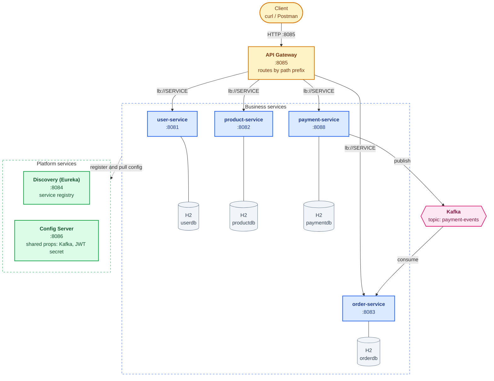

# Order Management Service

A Spring Cloud microservices backend simulating an e-commerce order flow — users, products, orders, and async payment processing via Kafka.

No frontend. All interaction is via REST (Postman / curl / API gateway at `:8085`).

---

## Architecture

### Topology



Every service registers with Eureka on startup and pulls config from the config server. Clients use only the gateway port. Docker Compose also publishes each service's port for local debugging.

### Runtime interaction — order orchestration

```
  order-service  (orchestrates an order)
        │
        ├─ REST  GET  /api/users/{id}      ─▶ user-service      validate user exists
        ├─ REST  GET  /api/products/{id}   ─▶ product-service   fetch price
        └─ REST  POST /api/payments (+JWT) ─▶ payment-service   charge
                                                   │
                                                   │ publish
                                                   ▼
                                       Kafka topic: payment-events
                                       { orderId, status }
                                                   │
                                                   │ consume
                                                   ▼
                                       order-service   update order status
```

### Communication

**Synchronous (REST)**

| Caller | Callee | Purpose |
|---|---|---|
| `api-gateway` | All services | Route every inbound request via Eureka `lb://` |
| `order-service` | `user-service` | Validate user exists on order placement |
| `order-service` | `product-service` | Fetch product price on order placement |
| `order-service` | `payment-service` | Trigger payment (JWT auth header) |

**Asynchronous (Kafka)**

| Producer | Consumer | Topic | Payload |
|---|---|---|---|
| `payment-service` | `order-service` | `payment-events` | `{"orderId":"...","status":"SUCCESS\|FAILED"}` |

### Order status lifecycle

```
                            ┌─▶ PAYMENT_SUCCESS
PLACED ─▶ PAYMENT_INITIATED ─┤
                            └─▶ PAYMENT_FAILED
```

`order-service` commits `PLACED` then `PAYMENT_INITIATED` before it calls
`payment-service`; the `payment-events` Kafka consumer sets the terminal status. If
the payment call fails, the circuit breaker fallback sets `PAYMENT_FAILED`.

### Security

```
POST /api/users/login
        │
        ▼
  user-service issues JWT (HS256)         ─┐
                                          │  shared signing secret
  order-service mints a service-level JWT ─┘  (from config server)
        │
        ▼
  POST /api/payments  +  Authorization: Bearer <jwt>
        │
        ▼
  payment-service validates the JWT before processing
```

`/api/payments/**` requires a valid JWT whose subject is `order-service`, so end-user tokens are rejected. All other endpoints are public. The `id` field in request bodies is ignored.

`user-service` stores passwords as BCrypt hashes and never returns them in responses.

The config server serves `jwt.secret` as an unresolved `${JWT_SECRET:...}` placeholder,
so `user-service`, `order-service`, and `payment-service` each read `JWT_SECRET` from
their own environment (base64-encoded, decoded length ≥ 32 bytes). All three must use
the same value. A default is provided for local development. Docker Compose passes the
host's `JWT_SECRET` to those three services when it's set.

---

## Services

| Service | Port | Key files |
|---|---|---|
| `discovery-server` | 8084 | `DiscoveryServerApplication.java` |
| `config-server` | 8086 | `application.yml`, `src/main/resources/config/` |
| `api-gateway` | 8085 | `application.yml` (routes) |
| `user-service` | 8081 | `UserController`, `UserServiceImpl`, `JwtUtil` |
| `product-service` | 8082 | `ProductController`, `ProductServiceImpl` |
| `order-service` | 8083 | `OrderServiceImpl`, `PaymentEventConsumer`, `JwtUtil` |
| `payment-service` | 8088 | `PaymentServiceImpl`, `JwtAuthenticationFilter`, `PaymentEventPublisher` |

---

## Tech Stack

| Layer | Technology |
|---|---|
| Language | Java 25 |
| Framework | Spring Boot 4.1.2, Spring Cloud 2025.1.4 |
| Service discovery | Netflix Eureka |
| API gateway | Spring Cloud Gateway |
| Config management | Spring Cloud Config (native / classpath) |
| Messaging | Apache Kafka (KRaft, single broker) |
| Inter-service HTTP | `RestTemplate` + Eureka client-side load balancing |
| Security | Spring Security + JWT HS256 (JJWT 0.12.6) |
| Resilience | Resilience4j circuit breaker (payment-service call) |
| Database | H2 in-memory (one per service) |
| Build | Maven multi-module |
| Containers | Docker + Docker Compose |

---

## API Reference

All requests go through the gateway at `http://localhost:8085`.

### User Service

| Method | Path | Auth | Description |
|---|---|---|---|
| `POST` | `/api/users` | public | Create a user |
| `GET` | `/api/users` | public | List all users |
| `GET` | `/api/users/{id}` | public | Get user by ID |
| `PUT` | `/api/users/{id}` | public | Update user (409 if the email is taken) |
| `DELETE` | `/api/users/{id}` | public | Delete user |
| `POST` | `/api/users/login` | public | Login — returns `{ "token": "..." }` (401 for invalid credentials) |

### Product Service

| Method | Path | Auth | Description |
|---|---|---|---|
| `POST` | `/api/products` | public | Create product (409 if the name is taken) |
| `GET` | `/api/products` | public | List all products |
| `GET` | `/api/products/{id}` | public | Get product by ID (404 if not found) |
| `PUT` | `/api/products/{id}` | public | Update product |
| `DELETE` | `/api/products/{id}` | public | Delete product |

### Order Service

| Method | Path | Auth | Description |
|---|---|---|---|
| `POST` | `/api/orders` | public | Place an order and trigger payment (404 if the user or product doesn't exist) |
| `GET` | `/api/orders` | public | List all orders |
| `GET` | `/api/orders/{id}` | public | Get order by ID (404 if not found) |

### Payment Service

| Method | Path | Auth | Description |
|---|---|---|---|
| `POST` | `/api/payments` | `order-service` JWT required | Process a payment (rejects end-user tokens with 403) |

---

## Data Flow — Place an Order

```
POST /api/orders  { userId, productId, quantity }
  │
  ▼ api-gateway
  │
  ▼ order-service
    ├─ GET /api/users/{userId}      → validate user exists
    ├─ GET /api/products/{id}       → fetch price
    ├─ totalPrice = price × quantity
    ├─ save Order { status: PLACED }
    ├─ save Order { status: PAYMENT_INITIATED }
    └─ POST /api/payments  (+ JWT)
         │
         ▼ payment-service
           ├─ validate JWT
           ├─ MockPaymentProvider  →  80% SUCCESS / 20% FAILED
           ├─ save PaymentResponse
           └─ publish → Kafka: payment-events { orderId, status }
                │
                ▼ order-service (Kafka consumer)
                  └─ update Order { status: PAYMENT_SUCCESS | PAYMENT_FAILED }
```

---

## Quick Start

### Docker (recommended — starts everything)

```bash
docker compose up -d
```

Waits for healthchecks in this order: Kafka → discovery-server → config-server → all business services.

The Dockerfiles use a BuildKit cache mount, `maven-repo`, so Maven downloads dependencies once across all images.

Check Eureka dashboard: `http://localhost:8084`

### Local Development

Prerequisites: Java 25, Maven 3.9+, Docker (for Kafka).

```bash
# Start Kafka only
docker compose up -d kafka

# Build all modules
mvn clean install -DskipTests

# Start services in order (each in its own terminal)
cd discovery-server && mvn spring-boot:run
cd config-server    && mvn spring-boot:run
cd user-service     && mvn spring-boot:run
cd product-service  && mvn spring-boot:run
cd payment-service  && mvn spring-boot:run
cd order-service    && mvn spring-boot:run
cd api-gateway      && mvn spring-boot:run
```

---

## Running Tests

```bash
# All services
mvn test

# Single service
mvn test -pl user-service
```

Service tests use `@SpringBootTest` + `MockMvc`, and `PaymentEventConsumerTest` uses Mockito. Config server and Eureka are disabled in the test profile via `src/test/resources/application.properties` in each service.

---

## Key Design Notes

- **H2 in-memory per service** — no external DB needed for local dev; data resets on restart.
- **Native config** — config-server serves YAML from `classpath:/config/` (no external Git repo).
- **Mock payment provider** — 80% SUCCESS / 20% FAILED, random transaction ID.
- **Circuit breaker** — Resilience4j wraps the order-service → payment-service call; on failure the order is saved as `PAYMENT_FAILED`. The call runs on a virtual thread with Resilience4j's default 1-second time limit.
- **No transaction around the payment call** — `placeOrder()` commits `PAYMENT_INITIATED` before calling `payment-service`, because the breaker's thread and the Kafka consumer can't see uncommitted rows and the event can arrive before the HTTP response.
- **Virtual threads** — the four business services handle requests on virtual threads, so blocking HTTP calls don't hold a platform thread.
- **AOT cache** — each Docker image trains a Java ahead-of-time cache during the build, which roughly halves service startup time.
- **Consumer failures** — malformed events and events with an unknown status are logged and skipped. Database failures retry every 5 seconds until the database recovers.
- **Publishing** — `payment-service` waits up to 5 seconds for Kafka to acknowledge an event. If publishing fails, the payment rolls back and returns an error, and `order-service` marks the order `PAYMENT_FAILED`.
- **Stale payments** — once a minute, `order-service` marks orders that have been in `PAYMENT_INITIATED` for 5 minutes as `PAYMENT_FAILED` (`order.payment-timeout`). A valid event that arrives later still sets the correct final status.
- **Fallback writes** — the circuit breaker fallback only changes an order that's still in `PAYMENT_INITIATED`, so it can't overwrite a final status.
